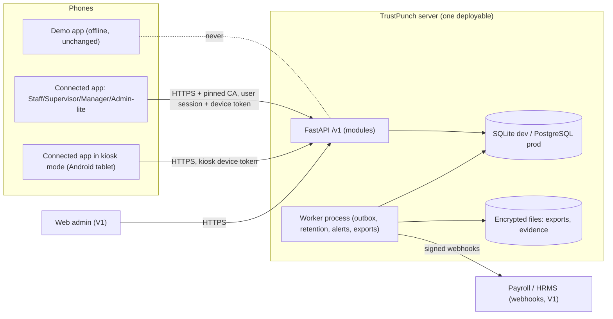

# TrustPunch Connected — platform plan

The **connected app** (`lib/main_connected.dart`, "TrustPunch Connected") and its
**server** (`backend/`) grow into a multi-site attendance platform: face + GPS
punches, kiosk mode, scheduling, leave, job time, approvals, policy engine,
payroll-ready exports, anomaly alerts, with role-based access for eight roles.

The **demo app** (`lib/main.dart`, "Trust Punch") stays exactly as it is:
offline, no accounts, no server.

This is a clean-room product. Commercial attendance products were a
*functional* reference only: no code, names, wording, screenshots, logos or
assets from them go into this repository.

Everything in this plan is run by you. Each day ends with what is done and the
exact commands, git included.

---

## Contents

1. [Ground rules](#1-ground-rules)
2. [Where we start (Day 0)](#2-where-we-start-day-0)
3. [MVP scope](#3-mvp-scope)
4. [Architecture](#4-architecture)
5. [Roles, scopes and the permission matrix](#5-roles-scopes-and-the-permission-matrix)
6. [API list](#6-api-list)
7. [Data model](#7-data-model)
8. [Security programme (MASVS, MASTG, API, privacy)](#8-security-programme)
9. [CI/CD with GitHub Actions](#9-cicd-with-github-actions)
10. [Daily task plan (MVP, 25 working days)](#10-daily-task-plan)
11. [V1 and V2 roadmap](#11-v1-and-v2-roadmap)
12. [MVP acceptance checklist](#12-mvp-acceptance-checklist)

---

## 1. Ground rules

**The demo app does not change.**

- Its app id, name, data folder and behaviour stay as they are.
- `lib/main.dart` never imports `lib/src/connected/`. `tool/check_demo_isolation.sh` enforces this, in CI and before every commit.
- Shared code (`lib/src/screens`, `lib/src/store`, `lib/src/services`) may gain *optional* hooks (parameters, interfaces). Their defaults must reproduce today's demo behaviour exactly.
- Every existing test passes unchanged, and `flutter build apk --flavor demo -t lib/main.dart` keeps building.
- Server features live in `lib/src/connected/` only.

**The phone captures; the server keeps the record.**

- Face match, liveness and GPS run on the phone, and a punch is saved on the phone first.
- The phone keeps working with no server for at least 7 days.
- The server stores each punch exactly once (the phone makes the id), re-checks what it can, and becomes the source of truth for the roster, policies, approvals and payroll.

**Security is a feature with a test.**

- Every control in [section 8](#8-security-programme) names the check that proves it: an automated test, a CI job, or a manual MASTG step.
- Security findings block a merge the same way failing tests do.

**Small, reviewable steps.**

- One branch per day, a pull request, CI green, squash merge.
- The repository is public: never commit keys, certificates, databases, `.env` files or real employee data.

---

## 2. Where we start (Day 0)

**Already built:**

| Area | State |
|---|---|
| Demo app | Complete offline app: roles, face + liveness, GPS geofence, projects, shifts, leave, corrections, overtime, SQLite storage |
| Connected flavour | Android `connected` flavour and iOS `connected` scheme, separate app id (`.connected`), entry `lib/main_connected.dart` |
| Connected code | `lib/src/connected/`: `server_api.dart` (HTTPS only; plain HTTP to loopback only), `device_token.dart` (Keychain/Keystore), `punch_sync.dart` (upload queue), `server_panel.dart` (pairing UI) |
| Server | FastAPI 0.165 + SQLite: `/health`, `/devices/pair`, `/devices/me`, `/workers/{id}/open-session`, `/punches/batch` |
| Server checks | Clock skew, future time, far from site, distance mismatch, site moved, out-of-order day; flags only, never refusals |
| Server security | HTTPS with a dev CA, one-time pairing codes (10 min, lockout), SHA-256-hashed device tokens, strict input models, 2 MB body limit, docs off by default |
| Tests | Flutter tests incl. `connected_test`, `server_panel_test`, `real_server_test` (e2e, runs when a server is set); backend `pytest` (health, pairing, punches) |
| Prototype | `prototype/attendance_prototype.html`: the worker-app screens the connected app should end up with |

**Not built yet:**

- User accounts and roles on the server
- A server-owned roster: sites, employees, shifts
- Kiosk allowlist sync
- Policy engine, leave and approvals on the server
- Reports, payroll export, audit log, alerts
- A web admin
- CI

**Open issues to settle on Day 1:**

- All current work is uncommitted on `main`.
- `.fvm` pins Flutter 3.47.9, but the `flutter` on your PATH is 3.44.2. `sqlite3` is pinned to 3.5.2 because of 3.44. CI currently uses 3.44.2.

---

## 3. MVP scope

The MVP is "one company, several sites, on a local server", but built
multi-tenant from the first table so the cloud later is a deployment change, not a
rewrite.

**In the MVP:**

| Module | MVP content |
|---|---|
| Auth | Username + password (argon2id), rotating sessions, TOTP MFA for admins, device pairing (exists), per-user device binding |
| RBAC | All 8 roles, scopes (tenant → region → site → team → shift → self), deny-by-default API, permission matrix as code |
| Org | Regions, sites, geofences (centre + radius + accuracy limit), teams, departments, projects, jobs (activities) |
| People | Employees, users, role assignment, contractor agencies (headcount cap, document expiry dates) |
| Time capture | Staff phone (1:1 face) and kiosk (1:N face), GPS geofence, offline queue ≥ 7 days, idempotent upload, server re-checks |
| Kiosk | Kiosk device registration, site allowlist (roster + encrypted face templates), offline, admin override with reason + audit |
| Scheduling | Shift templates, bulk assignment, weekly offs, holidays; staff see their schedule |
| Policy engine | Versioned rule sets: grace, late/early, OT threshold, breaks, rounding, auto-absence, weekly off/holiday; same maths on phone and server |
| Corrections & OT | Regularization requests, supervisor recommend → manager approve, overtime approval, audit |
| Leave | Types, allotments, balances, half day/hourly, apply/cancel, multi-level approval, leave & holiday calendars |
| Jobs | Tag punch to job (search, recent, QR), activity timesheet (draft/submit/approve), job-hours report |
| Reports | Attendance summary, late/early, overtime, leave, job hours; CSV + XLSX |
| Payroll | Period run, lock, reconciliation, export from approved data only |
| Alerts | Rule-based anomalies with reasons + review workflow (no ML in MVP) |
| Audit | Append-only, hash-chained audit events for every change and export |
| Privacy | Consent for face + location, retention jobs, per-employee export and erase |
| Mobile UI | Role-adaptive connected app: Staff (prototype screens), Supervisor board + exception queue, Manager approvals + dashboard, Admin-lite |

**Not in the MVP** (see [section 11](#11-v1-and-v2-roadmap)):

- Web admin dashboard
- SSO/SAML
- Push notifications (in-app only in the MVP)
- Live GPS tracking
- Play Integrity / App Attest
- PDF exports
- Webhooks to outside systems (built, but switched off)
- PostgreSQL row-level security
- ML anomaly model and AI daily summaries
- Cloud hosting

---

## 4. Architecture

### 4.1 System view



### 4.2 Decisions

| # | Decision | Why |
|---|---|---|
| A1 | **Modular monolith** (one FastAPI app, one worker), not microservices | One team, one local server. The spec's 16 "services" become modules with enforced boundaries; one could be split out later behind the same API. |
| A2 | **SQLAlchemy 2 + Alembic**, SQLite in dev/tests, **PostgreSQL in production** | Migrations from day one; same code on both databases; Postgres gives row-level security and concurrency for V1 |
| A3 | **`tenant_id` on every row**, taken from the session, never from the request | Multi-tenant later without a rewrite; tests prove one tenant cannot see another |
| A4 | **Opaque tokens, stored hashed** (access 15 min, refresh 30 days, rotated, reuse → revoke family), not JWTs | Instant revocation on a lost phone, same model as today's device tokens, nothing to leak in a JWT body |
| A5 | **Two credentials for a staff punch**: device token (this phone is paired and not blocked) + user session (this person is signed in). A kiosk has a device token with a `kiosk` principal | A stolen token alone cannot punch; a kiosk can only punch at its own site |
| A6 | **Phone-made UUIDv7 ids + `Idempotency-Key`** on every write | Offline retries never duplicate; order is recoverable |
| A7 | **Policy rules as versioned data** (JSON validated by Pydantic), evaluated by a pure function; results store the policy version | Payroll is reproducible; "what if" runs on past data; the same fixtures test the Dart and Python maths |
| A8 | **Face templates = encrypted embeddings only** (AES-256-GCM, per-tenant data key), raw face images never stored on the server; consent record required before enrolment | Biometric data is special-category data (UAE PDPL, GDPR, DPDP). Kiosks need templates to work offline. |
| A9 | **Transactional outbox + worker** for webhooks, notifications, exports, retention | No lost side effects, no work inside request handlers, retries with backoff |
| A10 | **Append-only, hash-chained audit log** | Tampering with history becomes detectable; required for corrections and payroll |
| A11 | **Problem Details errors (RFC 9457), cursor pagination, ETags** | Predictable clients, cheap roster sync |
| A12 | **Connected app follows the existing app's patterns** (`ChangeNotifier` store, plain `HttpClient`, `flutter_secure_storage`) | No second state-management style in one codebase |
| A13 | **Web admin in V1 = React + TypeScript (Vite) SPA** on the same `/v1` API | Tables, filters and exports are the web admin's job; the phone keeps "admin-lite" |

### 4.3 Server layout (target)

```
backend/
  app/
    main.py                 app factory: middleware, routers, startup checks
    core/
      config.py             settings from environment (pydantic-settings)
      db.py                 engine, session, tenant filter
      security.py           argon2id, token hashing, TOTP, encryption (AES-GCM)
      errors.py             RFC 9457 problem responses
      logging.py            structured JSON logs, request id, no personal data
      ratelimit.py          per principal + per IP
      idempotency.py        Idempotency-Key store
      pagination.py         cursor pagination
    rbac/
      permissions.py        permission codes + the matrix in section 5 (data)
      deps.py               require("leave.approve") dependency, scope check
    modules/                one folder per domain, same shape each:
      <module>/             router.py · schemas.py · service.py · repo.py · models.py
        auth  tenancy  users  devices  kiosks  org  employees  agencies
        shifts  attendance  policy  corrections  leave  jobs  reports
        payroll  alerts  notifications  audit  privacy  integrations
    worker/                 outbox runner, retention, alert rules, export jobs
    cli.py                  operator commands (exists; grows)
  migrations/               Alembic (0001 = today's schema exactly)
  tests/
    unit/ api/ authz/ contract/ e2e/
```

Layer rules, enforced by `tests/unit/test_architecture.py`:
- `router` → `service` → `repo` → `models`. Never the other way.
- A module only reaches another module through that module's `service`.
- `core` imports no module.

### 4.4 Connected app layout (target)

```
lib/
  main.dart                       demo — unchanged
  main_connected.dart             connected entry
  src/connected/
    app/        connected_app.dart, role router (which home for which role)
    core/       api/ (server_api, problem, retry), session/ (auth_session, secure token store), config
    sync/       outbox (punches, leave, corrections, timesheets), roster_sync (ETag), scheduler
    data/       repositories per feature over the local cache
    rbac/       permission codes mirrored from the server (only to hide UI; the server decides)
    features/   auth  staff_home  attendance  schedule  leave  timesheet  corrections
                supervisor_board  approvals  manager_dashboard  admin_lite  kiosk
                notifications  profile  settings  privacy
```

Today's four files move into this layout on Day 9 with `git mv`, so their history is kept.

---

## 5. Roles, scopes and the permission matrix

### 5.1 Roles

| Code | Role | Rank | Typical scope |
|---|---|---|---|
| `admin_l1` | Platform / super admin | 100 | Tenant |
| `admin_l2` | Org / HR-payroll admin | 90 | Assigned regions |
| `admin_l3` | Site / unit admin | 80 | Assigned sites |
| `manager_l1` | Regional manager | 70 | Assigned regions |
| `manager_l2` | Site / project manager | 60 | Assigned sites |
| `manager_l3` | Team manager | 50 | Assigned teams |
| `supervisor` | Shift / crew supervisor | 40 | Assigned teams, current shift |
| `staff` | Employee / contractor | 10 | Self |
| `kiosk` | *Device principal, not a person* | — | One site |

A person can hold several role assignments, each with its own scope. Example: a staff member at site A who is also a supervisor at site B.

**How this maps from today's app:**
- Worker "My own phone" → `staff` on a paired phone.
- Gate kiosk → a `kiosk` device.
- Supervisor PIN → `supervisor` or a manager signing in. The PIN stays as the offline unlock for an already signed-in session.

### 5.2 Scope codes in the matrix

`T` tenant · `R` assigned regions · `S` assigned sites · `M` own team(s) · `F` own crew on the current shift · `O` own records only · `—` none.

`Rd` = read only. `Rc` = recommend (a first-level opinion, not a decision). `*` = see note.

### 5.3 Permission matrix

| Permission | A-L1 | A-L2 | A-L3 | M-L1 | M-L2 | M-L3 | Sup | Staff |
|---|---|---|---|---|---|---|---|---|
| **Org / billing / global** | | | | | | | | |
| `tenant.read` / `tenant.update` | T / T | Rd / — | — | — | — | — | — | — |
| `billing.read` / `billing.update` | T / T | T* / — | — | — | — | — | — | — |
| `integrations.manage` (webhooks, API keys) | T | R | — | — | — | — | — | — |
| **Users & roles** | | | | | | | | |
| `users.read` | T | R | S | R | S | M | F | O |
| `users.create` / `users.update` | T | R | S | — | S* | — | — | O* |
| `users.deactivate` | T | R | S | — | — | — | — | — |
| `users.erase` (privacy erase) | T | R | — | — | — | — | — | — |
| `roles.assign` (only ranks below own) | T | R | S | R* | S* | — | — | — |
| **Sites / geofences / kiosks / devices** | | | | | | | | |
| `sites.read` | T | R | S | R | S | M | F | O |
| `sites.create` / `sites.delete` | T | R | — | — | — | — | — | — |
| `sites.update` / `geofences.manage` | T | R | S | — | S | — | — | — |
| `kiosks.read` | T | R | S | R | S | M | F | — |
| `kiosks.manage` (register, revoke) | T | R | S | — | S | — | — | — |
| `kiosks.override` (manual punch at kiosk) | T | R | S | — | S | — | F* | — |
| `devices.block` | T | R | S | — | S | — | — | O* |
| **Policies** | | | | | | | | |
| `policies.read` | T | R | S | Rd | Rd | — | — | — |
| `policies.edit` / `policies.publish` | T | R | — | — | — | — | — | — |
| **Shifts** | | | | | | | | |
| `shifts.read` | T | R | S | R | S | M | F | O |
| `shifts.manage` (templates, weekly offs, holidays) | T | R | S | R | S | — | — | — |
| `shifts.assign` | T | R | S | R | S | M | F* | — |
| `shifts.respond` (accept/decline own) | O | O | O | O | O | O | O | O |
| **Attendance** | | | | | | | | |
| `punch.create` (self, phone) | O | O | O | O | O | O | O | O |
| `attendance.read` | T | R | S | R | S | M | F | O |
| `attendance.live` (board) | T | R | S | R | S | M | F | — |
| `attendance.verify` (exception queue) | T | R | S | — | S | M | F | — |
| **Corrections & overtime** | | | | | | | | |
| `corrections.request` (self) | O | O | O | O | O | O | O | O |
| `corrections.request_for` (on behalf) | T | R | S | — | S | M | F | — |
| `corrections.recommend` | — | — | — | — | — | — | F | — |
| `corrections.approve` / `overtime.approve` | T | R | S | R | S | M | — | — |
| **Leave** | | | | | | | | |
| `leave.apply` (self) / `leave.cancel` (own, pending) | O | O | O | O | O | O | O | O |
| `leave.apply_for` | T | R | S | — | S | M | — | — |
| `leave.recommend` | — | — | — | — | — | — | F | — |
| `leave.approve` | T | R | S | R | S | M | — | — |
| `leave.configure` (types, allotments) | T | R | — | — | — | — | — | — |
| **Jobs / activities** | | | | | | | | |
| `jobs.read` | T | R | S | R | S | M | F | O |
| `jobs.manage` | T | R | S | R | S | — | — | — |
| `jobs.assign` (tasks) | T | R | S | R | S | M | F | — |
| `activity.submit` (own timesheet) | O | O | O | O | O | O | O | O |
| `activity.approve` | T | R | S | R | S | M | F* | — |
| **Reports & exports** | | | | | | | | |
| `reports.read` | T | R | S | R | S | M | F | O |
| `reports.export` (CSV/XLSX) | T | R | S | R | S | M | — | O |
| **Payroll** | | | | | | | | |
| `payroll.read` | T | R | Rd | Rd | Rd | — | — | — |
| `payroll.run` / `payroll.lock` / `payroll.export` | T | R | — | — | — | — | — | — |
| **Audit / AI alerts / privacy** | | | | | | | | |
| `audit.read` | T | R | S | R | S | — | — | — |
| `alerts.read` | T | R | S | R | S | M | F | O* |
| `alerts.review` (confirm / dismiss) | T | R | S | R | S | M | — | — |
| `face.enroll` (for others) / `face.delete` | T | R | S | — | S | — | F* / — | O* / — |
| `privacy.export` / `privacy.erase` (per employee) | T | R | — | — | — | — | — | O* (request) |

**Notes (`*` in the matrix):**

- `billing` for A-L2: only when A-L1 has delegated it (a tenant setting).
- `users.update`:
  - M-L2 may edit supervisors and staff at its sites, nobody else.
  - Staff may edit only their own phone number and photo; other fields are locked, as the prototype shows.
- `roles.assign`:
  - Only roles of a lower rank than your own, and never to yourself.
  - M-L1 may assign M-L2/M-L3/Supervisor in its regions.
  - M-L2 may assign M-L3/Supervisor/Staff at its sites.
- `kiosks.override` for a supervisor: only on the kiosk at their own site during their shift, with a reason, and it raises an alert for review.
- `devices.block` for staff: your own lost phone only.
- `shifts.assign` for a supervisor: moving crew between slots of their own shift. A supervisor cannot create shifts.
- `activity.approve` for a supervisor: verification of crew entries. The manager's approval is final.
- `alerts.read` for staff: only alerts about yourself, shown as notifications.
- `face.enroll`:
  - A supervisor enrols their crew on site.
  - Staff may self-enrol only if tenant policy allows it.
  - Every enrolment needs a consent record.
- `privacy` for staff: you can request an export or erasure of your own data; an admin carries it out.

### 5.4 API authorization rules

1. **Deny by default.** Every route declares a permission with `Depends(require("leave.approve"))`. At startup the app refuses to start if any route has none, except `GET /health`, `GET /v1/meta/version`, `POST /v1/auth/login`, `POST /v1/auth/refresh` and `POST /v1/devices/pair`. A test also lists every route and checks this.
2. **Tenant isolation.**
   - `tenant_id` comes from the session only.
   - Every repository query is tenant-filtered by the session object, not by hand.
   - V1 adds PostgreSQL row-level security as a second wall.
3. **Object-level checks (OWASP API1 / BOLA).**
   - The service loads the object's `(tenant, region, site, team, employee)` first, then checks it against the caller's grants for that permission.
   - Out of scope returns **404**, not 403, so ids cannot be probed.
4. **Function-level checks (API5).** Approve, export, lock, override and assign are separate permissions, never implied by "update".
5. **Property-level checks (API3).**
   - Request models forbid unknown fields (as today).
   - Response models are per role, e.g. staff never receive other people's leave reasons, and a kiosk never receives phone numbers.
6. **No privilege escalation.**
   - You can assign only roles ranked below your own, never to yourself.
   - You can't edit your own role assignments or your own attendance.
7. **Segregation of duties.**
   - Nobody approves their own correction, leave, overtime or timesheet.
   - Payroll lock needs a different person from the payroll run when the tenant enables "four eyes" (V1 default on).
8. **Multi-level approval.**
   - Level *n* can decide only after level *n − 1* has decided.
   - Decisions are final. Reversal is a new, audited request.
9. **Device binding for punches.**
   - A staff punch needs a device token and a user session.
   - The device must be bound to that user (1:1 phone), or be a kiosk at the punch's site.
   - A blocked device is refused everywhere.
10. **Rate limits.**
    - Login: 5 per account per 15 minutes.
    - Pairing: as today.
    - Writes: per principal.
    - Exports: 10 per hour per user.
    - `429` responses carry `Retry-After`.
11. **Every export and every approval writes an audit event**, recording who, what, the filters, the row count and the time.

---

## 6. API list

### Conventions

| Topic | Rule |
|---|---|
| Base | `/v1/...`, JSON, UTF-8, HTTPS only (plain HTTP to loopback for tests only) |
| Auth | `Authorization: Bearer <access token>`; phones and kiosks also send `X-Device-Token: <device token>` from Day 9 |
| Writes | `Idempotency-Key: <uuid>` required on every `POST` that creates; repeats return the first response for 24 h |
| Ids | UUIDv7; ids of offline records are made on the phone |
| Lists | `?limit=50&cursor=…` → `{ "items": [], "next_cursor": "…" }`; max `limit` 200 |
| Sync | `ETag` / `If-None-Match` on roster and allowlist; `?since=<cursor>` for changes |
| Errors | RFC 9457 `application/problem+json` with `type`, `title`, `status`, `detail`, `errors[]` |
| Times | RFC 3339 with offset; days as `YYYY-MM-DD` in the site's timezone |
| Versioning | Breaking change → `/v2`; `GET /v1/meta/version` gives the minimum app version (forced update) |
| Docs | OpenAPI at `/openapi.json` only with `TRUSTPUNCH_DEBUG=1`; a copy is committed at `docs/openapi.json` and CI fails if it drifts |

**Phase:** `Built` already works · `D-n` = MVP day it is built · `V1` / `V2` = later.

### 6.1 Platform, auth, devices

| Method | Path | Purpose | Permission | Phase |
|---|---|---|---|---|
| GET | `/health` | Liveness | public | Built |
| GET | `/v1/health/ready` | Readiness (database, migrations) | public | D-2 |
| GET | `/v1/meta/version` | Server version, minimum app version | public | D-2 |
| POST | `/v1/auth/login` | Password login → tokens, or an MFA challenge | public, rate-limited | D-3 |
| POST | `/v1/auth/mfa/verify` | TOTP code → tokens | challenge token | D-5 |
| POST | `/v1/auth/refresh` | Rotate refresh token | refresh token | D-3 |
| POST | `/v1/auth/logout` | Revoke this session (or all with `?all=true`) | session | D-3 |
| GET | `/v1/me` | Me, my role assignments, scopes, permission codes | session | D-4 |
| PATCH | `/v1/me` | Own phone number / photo only | `users.update` (O) | D-7 |
| POST | `/v1/me/password` | Change password (old password required) | session | D-3 |
| POST / DELETE | `/v1/me/mfa/totp` | Enrol / remove TOTP | session (+MFA to remove) | D-5 |
| GET | `/v1/me/sessions` · DELETE `/v1/me/sessions/{id}` | My sessions, sign one out | session | D-5 |
| POST | `/devices/pair` → `/v1/devices/pair` | Pairing code → device token | public, rate-limited | Built → D-2 |
| GET | `/devices/me` → `/v1/devices/me` | This device | device token | Built → D-2 |
| POST | `/v1/pair-codes` | Make a one-time pairing code (replaces the CLI) | `kiosks.manage` / `devices.block` | D-6 |
| GET | `/v1/devices` | Devices in scope | `devices.block` | D-6 |
| POST | `/v1/devices/{id}/block` · `/unblock` | Stop a lost phone | `devices.block` | D-6 |
| POST | `/v1/devices/{id}/bind` | Bind a phone to one user (1:1) | `users.update` | D-9 |
| POST | `/v1/auth/otp/request` · `/verify` | SMS / email OTP login | public | V1 |
| GET | `/v1/auth/sso/{provider}/start` · `/callback` | OIDC / SAML | public | V1 |

### 6.2 Tenancy, org, people

| Method | Path | Purpose | Permission | Phase |
|---|---|---|---|---|
| GET / PATCH | `/v1/tenant` | Company settings, timezone, locale, feature flags | `tenant.read` / `tenant.update` | D-6 |
| CRUD | `/v1/regions` | Regions | `sites.create` (write) / `sites.read` | D-6 |
| CRUD | `/v1/sites` | Sites (timezone, address) | `sites.*` | D-6 |
| CRUD | `/v1/sites/{id}/geofences` | Circle (centre, radius, max GPS accuracy) per site / zone | `geofences.manage` | D-6 |
| CRUD | `/v1/teams` · `/v1/departments` | Teams, departments | `users.create` | D-6 |
| CRUD | `/v1/projects` · `/v1/projects/{id}/jobs` | Projects and their jobs (activities, cost codes, QR value) | `jobs.manage` | D-6 |
| CRUD | `/v1/users` | Sign-in accounts | `users.*` | D-7 |
| POST / DELETE | `/v1/users/{id}/roles` | Assign / remove a role with its scope | `roles.assign` | D-7 |
| CRUD | `/v1/employees` | Employee records (code, name, type, agency, team, sites) | `users.*` | D-7 |
| POST / DELETE | `/v1/employees/{id}/assignments` | Project + role + job assignments | `users.update` | D-7 |
| POST | `/v1/employees/{id}/deactivate` | Leaver: stops punching, starts retention clock | `users.deactivate` | D-7 |
| CRUD | `/v1/agencies` | Contractor agencies, headcount cap | `users.create` | D-7 |
| CRUD | `/v1/agencies/{id}/documents` | Agency documents with expiry date (metadata; file in V1) | `users.update` | D-7 |
| POST | `/v1/employees/{id}/consents` · GET | Face / location consent records (text version, time, device) | `face.enroll` / O | D-10 |
| POST | `/v1/employees/{id}/face-templates` | Upload encrypted embedding(s) (consent id required) | `face.enroll` | D-10 |
| DELETE | `/v1/employees/{id}/face-templates` | Delete all templates | `face.delete` | D-10 |

### 6.3 Sync, attendance, kiosks

| Method | Path | Purpose | Permission | Phase |
|---|---|---|---|---|
| GET | `/v1/sync/roster` | Sites, geofences, shifts, projects, jobs, people this device may see (ETag, `since`) | session or kiosk | D-9 |
| GET | `/v1/sync/config` | Published policy version, holidays, app settings | session or kiosk | D-12 |
| POST | `/punches/batch` → `/v1/punches:batch` | Upload up to 500 punches; idempotent by id; returns per-punch flags | `punch.create` / kiosk | Built → D-11 |
| GET | `/workers/{id}/open-session` → `/v1/employees/{id}/open-session` | Is this person on the clock somewhere | `attendance.read` / kiosk | Built → D-11 |
| GET | `/v1/punches` | Punches by employee / site / day range | `attendance.read` | D-11 |
| GET | `/v1/attendance/days` | Computed day records (worked, break, travel, late, early, OT, flags) | `attendance.read` | D-13 |
| GET | `/v1/attendance/live` | Live board: on site, on break, late, absent, at another site | `attendance.live` | D-13 |
| GET | `/v1/attendance/exceptions` | Exception queue (flags, missing punches, overrides) | `attendance.verify` | D-13 |
| POST | `/v1/attendance/days/{id}/verify` | Supervisor confirms or flags a day | `attendance.verify` | D-13 |
| CRUD | `/v1/kiosks` | Register (returns pairing code), rename, revoke | `kiosks.manage` | D-16 |
| GET | `/v1/kiosks/self/allowlist` | Site roster + encrypted templates for this kiosk (ETag) | kiosk | D-16 |
| POST | `/v1/kiosks/self/overrides` | Manual punch at kiosk: admin PIN + reason; raises an alert | kiosk + `kiosks.override` | D-16 |
| POST | `/v1/location-pings` | Live location during shift (consent required) | `punch.create` | V1 |
| GET | `/v1/tracking/live` | Live field map | `attendance.live` | V1 |

### 6.4 Corrections, overtime, scheduling, leave

| Method | Path | Purpose | Permission | Phase |
|---|---|---|---|---|
| POST | `/v1/corrections` | Missed check-in/out request with reason | `corrections.request` / `_for` | D-14 |
| GET | `/v1/corrections` | List by status / employee / site | `attendance.read` | D-14 |
| POST | `/v1/corrections/{id}/recommend` · `/approve` · `/reject` | Decisions (final, audited) | `corrections.*` | D-14 |
| POST | `/v1/corrections/{id}/withdraw` | Requester withdraws while pending | O | D-14 |
| GET | `/v1/overtime` | Days with overtime waiting | `overtime.approve` | D-14 |
| POST | `/v1/overtime/{dayId}/approve` · `/reject` | Approve minutes (≤ that day's overtime) | `overtime.approve` | D-14 |
| CRUD | `/v1/shifts` | Shift templates (start, end, grace, break rule, days) | `shifts.manage` | D-8 |
| POST | `/v1/shift-assignments:bulk` | Assign many people × days | `shifts.assign` | D-8 |
| GET | `/v1/shift-assignments` | Schedule by person / site / range | `shifts.read` | D-8 |
| POST | `/v1/shift-assignments/{id}/accept` · `/decline` | Staff response | `shifts.respond` | D-8 |
| CRUD | `/v1/weekly-offs` · `/v1/holidays` | Weekly-off rules, holiday calendar per site | `shifts.manage` | D-8 |
| CRUD | `/v1/rotations` | Rotating shift patterns | `shifts.manage` | V1 |
| CRUD | `/v1/leave-types` | Types (paid, unpaid, half day, hourly, sandwich rule, carry forward) | `leave.configure` | D-15 |
| CRUD | `/v1/leave-allotments` | Yearly allotment per type / employee group | `leave.configure` | D-15 |
| GET | `/v1/employees/{id}/leave-balances` | Used / pending / balance per type | `attendance.read` (O for self) | D-15 |
| POST | `/v1/leave-requests` | Apply (type, range, half day / hours, reason, attachment ref) | `leave.apply` / `_for` | D-15 |
| GET | `/v1/leave-requests` | History by status | `attendance.read` | D-15 |
| POST | `/v1/leave-requests/{id}/cancel` · `/recommend` · `/approve` · `/reject` | Workflow | `leave.*` | D-15 |
| GET | `/v1/leave-calendar` | Who is away, by site / month | `attendance.read` | D-15 |

### 6.5 Jobs, policies, reports, payroll, alerts, audit, privacy, integrations

| Method | Path | Purpose | Permission | Phase |
|---|---|---|---|---|
| POST | `/v1/activity-entries:batch` | Activity timesheet rows (job, activity, hours) | `activity.submit` | D-17 |
| GET | `/v1/activity-entries` | By person / job / range | `jobs.read` | D-17 |
| POST | `/v1/activity-days/{date}/submit` · `/approve` · `/reject` | Day workflow | `activity.*` | D-17 |
| CRUD | `/v1/tasks` | Assign a task / job to a person or crew for a day | `jobs.assign` | D-17 |
| GET | `/v1/policies` · `/v1/policies/{id}` | Rule sets and versions | `policies.read` | D-12 |
| POST | `/v1/policies` · PATCH (draft only) | Create / edit a draft | `policies.edit` | D-12 |
| POST | `/v1/policies/{id}/publish` | Publish a new version (from a date) | `policies.publish` | D-12 |
| POST | `/v1/policies:simulate` | Dry-run a draft on past days; show the differences | `policies.edit` | D-12 |
| GET | `/v1/reports/attendance-summary` · `/late-early` · `/overtime` · `/leave` · `/job-hours` | Report data (paginated) | `reports.read` | D-18 |
| POST | `/v1/exports` | Start an export job (report, filters, `csv` / `xlsx`) | `reports.export` | D-18 |
| GET | `/v1/exports/{id}` · `/v1/exports/{id}/file` | Status, then a one-time download | `reports.export` (owner) | D-18 |
| POST | `/v1/payroll-runs` | Calculate a period from approved data | `payroll.run` | D-19 |
| GET | `/v1/payroll-runs` · `/{id}` · `/{id}/reconciliation` | Results, reconciliation against attendance | `payroll.read` | D-19 |
| POST | `/v1/payroll-runs/{id}/lock` · `/export` | Lock the period, export the payroll file | `payroll.lock` / `payroll.export` | D-19 |
| GET | `/v1/alerts` · `/v1/alerts/{id}` | Anomalies with reasons and evidence | `alerts.read` | D-20 |
| POST | `/v1/alerts/{id}/review` | Confirm / dismiss with a note | `alerts.review` | D-20 |
| GET | `/v1/notifications` · POST `/{id}/read` | In-app notifications | session | D-20 |
| GET / PUT | `/v1/me/notification-preferences` | App / email / SMS preferences | session | D-20 |
| POST | `/v1/me/push-tokens` | FCM / APNs token | session | V1 |
| GET | `/v1/insights/daily-summary` | Manager assist summary (explainable) | `alerts.read` | V1 |
| GET | `/v1/audit-events` | Audit trail (filter by actor, object, action) | `audit.read` | D-5 |
| GET | `/v1/audit-events/verify` | Check the hash chain | `audit.read` | D-5 |
| POST | `/v1/privacy/employees/{id}/export` | Personal data export job | `privacy.export` | D-24 |
| POST | `/v1/privacy/employees/{id}/erase` | Erase / anonymise (keeps legally required payroll totals) | `privacy.erase` | D-24 |
| GET / PUT | `/v1/privacy/retention` | Retention periods (selfies, templates, punches, logs) | `tenant.update` | D-24 |
| CRUD | `/v1/webhooks` · GET `/{id}/deliveries` · POST `/redeliver` | Signed (HMAC-SHA256) outgoing events | `integrations.manage` | D-19 (off) / V1 |
| CRUD | `/v1/api-keys` | Server-to-server keys for HRMS / payroll | `integrations.manage` | V1 |

---

## 7. Data model

Every table has:
- `id` (UUIDv7)
- `tenant_id` (except the `tenants` table itself)
- `created_at`, `updated_at`
- `version` (optimistic locking; a stale update returns `409`)

Soft delete is used only where history needs the row (employees, sites, jobs).

| Entity | Key fields |
|---|---|
| Tenant | name, timezone, locale, settings (JSON), feature flags |
| User | username, email, password_hash (argon2id), mfa_secret (encrypted), status, failed_logins, locked_until |
| RoleAssignment | user_id, role, scope_type (`tenant` / `region` / `site` / `team`), scope_id, granted_by |
| Session | user_id, device_id, access_hash, refresh_hash, family_id, expires_at, revoked_at |
| Device | name, platform, token_hash, kind (`phone` / `kiosk`), bound_user_id, site_id (kiosk), blocked, last_seen_at, app_version |
| Region / Site / Geofence | Site: timezone, address. Geofence: lat, lng, radius_m, max_accuracy_m, zone name |
| Team / Department | name, site_id, manager user ids |
| Project / Job | project; job: code, name, cost_code, qr_value, active |
| Employee | code, names, type (`employee` / `contractor`), agency_id, team_id, home_site_id, user_id, status, joined_on, left_on |
| Assignment | employee_id, project_id, role, job_id |
| ContractorAgency / AgencyDocument | headcount_cap; document type, number, expires_on |
| Consent | employee_id, kind (`face` / `location`), text_version, given_at, withdrawn_at, device_id |
| FaceTemplate | employee_id, model (`mobilefacenet-192`), ciphertext, nonce, key_id, angle, consent_id |
| ShiftTemplate / ShiftAssignment / WeeklyOff / Holiday | times, grace, break rule; assignment: employee, day, status |
| Punch | phone-made id, device_id, employee_id, site_id, type, at, gps (lat, lng, accuracy), distance_m, source (`phone` / `kiosk` / `override` / `correction` / `auto`), job_id, flags[], replaced_by |
| AttendanceDay | employee, day, worked/break/travel minutes, late/early minutes, overtime, policy_version, status, verified_by |
| Correction / OvertimeDecision | requested_by, decisions[] (level, actor, decision, note, at) |
| LeaveType / LeaveAllotment / LeaveRequest | rules; allotment per year; request: type, from, to, part, hours, status, decisions[] |
| ActivityEntry / ActivityDay / Task | job, activity, hours, status |
| Policy / PolicyVersion | name, scope (site / type / department / agency), rules (JSON), effective_from, published_by |
| PayrollRun / PayrollLine | period, status (`draft` / `locked` / `exported`), totals; line per employee |
| Alert | kind, subject employee/device, score, reasons[] (human-readable), evidence refs, status, reviewed_by |
| Notification | user_id, kind, payload, read_at |
| AuditEvent | actor, action, object type/id, before/after (diff), ip, device, prev_hash, hash |
| OutboxEvent | topic, payload, attempts, next_attempt_at, done_at |
| IdempotencyRecord | key, principal, request hash, response, expires_at |
| Export | requested_by, report, filters, format, file path (encrypted), row_count, expires_at |

---

## 8. Security programme

### 8.1 Mobile: OWASP MASVS v2 → controls → MASTG verification

**Status:** ✅ done today · 🔜 planned (the day number is in brackets) · ⚠️ known gap.

**MASVS-STORAGE**

- **STORAGE-1** Sensitive data stored securely
  - ✅ Tokens in Keychain/Keystore (`flutter_secure_storage`).
  - 🔜 Session tokens, same store (D9).
  - 🔜 Connected database encrypted with SQLCipher, key in Keychain/Keystore (D21).
  - **How we check it:** MASTG storage tests. On a rooted/jailbroken test device, inspect the app sandbox: no token, password or embedding in plain files, prefs or logs. Search the APK/IPA with `jadx` and `strings`.
- **STORAGE-2** No leakage
  - ✅ Android backup off.
  - ⚠️ iOS backup exclusion not done; fixed on D21.
  - 🔜 Screenshot blocking on sensitive screens, no attendance data in logs (D21).
  - **How we check it:** `idevicebackup2` backup and search; `adb logcat` while using the app; MobSF.

**MASVS-CRYPTO**

- **CRYPTO-1** Strong, current cryptography
  - 🔜 Server: argon2id, AES-256-GCM, SHA-256 token hashes.
  - Phone: platform keystores only, no hand-written cryptography.
  - **How we check it:** mobsfscan / MobSF crypto rules; code review checklist.
- **CRYPTO-2** Key management
  - 🔜 Per-tenant data keys wrapped by a master key held outside the database (D10).
  - Keys are never in the repository; gitleaks guards that.
  - **How we check it:** gitleaks in CI; review of key rotation.

**MASVS-AUTH**

- **AUTH-1** Secure authentication
  - ✅ Device pairing.
  - 🔜 Password + rotating sessions (D3), MFA for admins (D5).
  - **How we check it:** API tests (refresh-reuse revokes the family, lockout, logout invalidates); MASTG auth tests with a proxy.
- **AUTH-2** Local auth done safely
  - 🔜 Biometric / PIN unlock only unlocks a stored session, bound to the Keystore/Keychain (D9).
  - **How we check it:** MASTG local-auth tests with Frida/objection: bypassing the prompt gives no token.
- **AUTH-3** Step-up for sensitive actions
  - 🔜 Approvals, payroll and erase need a recent login or MFA (D5, D19).
  - **How we check it:** API tests.

**MASVS-NETWORK**

- **NETWORK-1** Secure traffic
  - ✅ HTTPS only (except loopback).
  - 🔜 Android `network_security_config` without cleartext; iOS ATS on (D21).
  - **How we check it:** MobSF manifest/plist checks; mitmproxy shows no plain HTTP.
- **NETWORK-2** Pinning
  - ✅ The dev build trusts only the dev CA.
  - 🔜 Production pins the server's SPKI (2 pins, rotation plan) (D21).
  - **How we check it:** MASTG pinning test: mitmproxy with a user CA fails; `objection … android sslpinning disable` must be needed to intercept.

**MASVS-PLATFORM**

- **PLATFORM-1** IPC safe
  - 🔜 No exported Android components except the launcher; no custom URL schemes in the MVP (D21).
  - **How we check it:** `apktool d` and a manifest review; MobSF.
- **PLATFORM-2** WebViews safe
  - ✅ No WebView. The OSM map is tiles only.
  - **How we check it:** MobSF.
- **PLATFORM-3** UI safe
  - 🔜 Sensitive screens hidden in the app switcher; no personal data in notifications on the lock screen (D21).
  - **How we check it:** Manual MASTG UI test.

**MASVS-CODE**

- **CODE-1** Up-to-date platform
  - Android minSdk 26, iOS 15.5.
  - 🔜 The server refuses app versions below `minimum_app_version` (D2).
  - **How we check it:** CI; API test.
- **CODE-2** Update mechanism
  - 🔜 `GET /v1/meta/version` drives forced updates (D9).
  - **How we check it:** Widget test.
- **CODE-3** No vulnerable components
  - ✅ (from Day 1) OSV-Scanner, pip-audit, Dependabot.
  - **How we check it:** CI jobs.
- **CODE-4** Input validated
  - ✅ Strict server models.
  - 🔜 The phone validates QR / job codes and server payloads (D9, D17).
  - **How we check it:** Schemathesis and ZAP nightly; Dart unit tests.

**MASVS-RESILIENCE**

- **RESILIENCE-1** Platform integrity
  - ✅ Jailbreak/emulator check.
  - 🔜 The signal is sent with each punch; the server flags the punch (D21).
  - 🔜 Play Integrity / App Attest (V1).
  - **How we check it:** MASTG resilience tests on a rooted device: the punch is flagged.
- **RESILIENCE-2** Anti-tampering
  - 🔜 Release builds signed in CI from secrets; signature checked at runtime (V1).
  - **How we check it:** Repackage with `apktool b` + re-sign: the app refuses or the server flags it.
- **RESILIENCE-3** Anti-static analysis
  - 🔜 `--obfuscate --split-debug-info` (already in CI builds); no secrets in the binary.
  - **How we check it:** `jadx`, `strings`, `blutter` / `reFlutter` review.
- **RESILIENCE-4** Anti-dynamic analysis
  - 🔜 Debugger / Frida detection as a *signal* (flag, not crash) (D21).
  - **How we check it:** Frida attach: the punch is flagged.

**MASVS-PRIVACY**

- **PRIVACY-1** Minimise access
  - Location only while punching; camera only at capture.
  - 🔜 No background location in the MVP.
  - **How we check it:** Permission review; MobSF.
- **PRIVACY-2** No unnecessary identification
  - 🔜 Embeddings, not photos; selfies are evidence with a retention limit (D10, D24).
  - **How we check it:** Data-flow review; API tests.
- **PRIVACY-3** Transparency
  - 🔜 Consent screens for face and location, a privacy notice, and a "what we store" screen (D10, D24).
  - **How we check it:** Manual test against the notice.
- **PRIVACY-4** User control
  - 🔜 Withdraw consent, request export/erase (D24).
  - **How we check it:** API + e2e tests.

### 8.2 Server: OWASP API Security Top 10 (2023)

| Risk | Control | Test |
|---|---|---|
| API1 Broken object level authorization | Scoped repositories, 404 outside scope | `tests/authz/test_matrix.py`: every role × every endpoint × in/out-of-scope object |
| API2 Broken authentication | argon2id, lockout, rotating refresh, MFA, hashed tokens | Auth tests; Schemathesis |
| API3 Broken object property level authorization | `extra="forbid"` requests, per-role response models | Property tests per role |
| API4 Unrestricted resource consumption | Body limit, batch ≤ 500, pagination max 200, rate limits, export quotas | Load tests (D23), Schemathesis |
| API5 Broken function level authorization | Every route declares a permission; startup refuses missing ones | Route-coverage test |
| API6 Unrestricted access to sensitive flows | Rate limits on login, pairing, OTP, exports; kiosk override raises an alert | API tests |
| API7 SSRF | The server makes no outbound calls except webhooks: https only, no private IP ranges, no redirects | Unit tests on the URL validator |
| API8 Security misconfiguration | Docs off, security headers, CORS closed (open only to the web admin origin in V1), TLS 1.2+ | ZAP nightly |
| API9 Improper inventory management | Committed `docs/openapi.json`, CI drift check, legacy paths removed on D11 | CI |
| API10 Unsafe consumption of APIs | Validate every inbound webhook / SSO response (V1) | Contract tests |

### 8.3 Attendance-specific threats (STRIDE)

| Threat | Example | Control |
|---|---|---|
| Spoofing | Photo, video or mask in front of the camera | Liveness challenge (exists); passive liveness (V2); the kiosk 1:N runner-up margin; alert on low-margin matches |
| Spoofing | Buddy punching with a friend's phone | Device bound to one user; a face match is required; alert when one device punches for many people |
| Spoofing | Fake GPS app | Android `isMock` / iOS `isSimulatedBySoftware` flags; accuracy limit; server distance re-check; impossible-travel alert |
| Tampering | Phone clock moved | Existing clock checks + server clock-skew flag |
| Tampering | Admin edits attendance quietly | Every change is a new audited record; hash-chained audit; segregation of duties |
| Repudiation | "I never approved that" | Audit event with actor, device, IP and time; step-up MFA on approvals |
| Information disclosure | Kiosk screen shows other people's data | Kiosk responses carry the minimum fields; no leave reasons at the gate (existing rule) |
| Information disclosure | Stolen server disk | Encrypted templates and exports; Postgres on an encrypted volume; backups encrypted |
| Denial of service | Flood of punch uploads | Rate limits per device, batch caps, body limit |
| Elevation of privilege | Manager gives themselves admin | Rank rule, no self-assignment, audit + alert |

### 8.4 When each security test runs

| When | What | Where |
|---|---|---|
| Every commit (local) | `tool/check_demo_isolation.sh`, `dart analyze lib`, `pytest -q`, `gitleaks git --pre-commit --staged` | Your Mac |
| Every pull request | Demo isolation, Flutter tests, backend tests, Bandit, pip-audit, e2e, gitleaks, OSV, CodeQL (Python + Actions), mobsfscan | `ci.yml`, `security.yml` |
| Nightly | Schemathesis fuzzing, OWASP ZAP API scan, MobSF on the release APK | `security.yml` (scheduled) |
| Weekly | Dependabot pull requests (pub, pip, actions) | `dependabot.yml` |
| Each release candidate | Manual MASTG pass ([8.5](#85-manual-mastg-pass-run-it-yourself)), authz matrix review, threat model update | You, Day 22 + every release |
| Before real employee data | An independent penetration test of the app and the API | External |

### 8.5 Manual MASTG pass (run it yourself)

**One-time tools:**

```bash
brew install apktool jadx mitmproxy libimobiledevice
python3 -m pip install --user pipx && python3 -m pipx ensurepath
pipx install frida-tools
pipx install objection
```

**1. Build the release APK you will test (obfuscated, like CI):**

```bash
flutter build apk --release --flavor connected -t lib/main_connected.dart \
  --obfuscate --split-debug-info=build/symbols/connected \
  --dart-define=API_BASE_URL=https://$(ipconfig getifaddr en0):8443 \
  --dart-define=API_DEV_CA=$(base64 -i backend/certs/dev-ca.pem)
APK=build/app/outputs/flutter-apk/app-connected-release.apk
```

**2. Static checks (STORAGE, CODE, PLATFORM, RESILIENCE-3):**

```bash
apktool d -f "$APK" -o /tmp/tp-apk
grep -nE 'debuggable|allowBackup|exported|usesCleartextTraffic|networkSecurityConfig' /tmp/tp-apk/AndroidManifest.xml
jadx -d /tmp/tp-jadx "$APK"
grep -rniE 'BEGIN (EC |RSA )?PRIVATE KEY|api[_-]?key|secret|password' /tmp/tp-jadx /tmp/tp-apk | head
strings -n 8 /tmp/tp-apk/lib/arm64-v8a/libapp.so | grep -iE 'https?://|token|secret' | head
```

Expected:
- Not debuggable, `allowBackup=false`.
- Only the launcher activity is exported.
- No cleartext traffic, no keys.
- The only URL is the one passed with `API_BASE_URL`.

**3. Network (NETWORK-1/2):**

1. Start `mitmweb --listen-port 8080`.
2. Set the phone's Wi-Fi proxy to your Mac on port 8080 and install the mitmproxy CA on the phone.
3. Open the app and punch.

Expected: the app's requests **fail**, because it does not trust the user CA. Then:

```bash
objection -g com.example.trust_punch.connected explore     # rooted test device or emulator
# inside objection:
android sslpinning disable
```

Only after this can traffic be read, and the server must still refuse a replayed or edited punch (idempotency + validation).

**4. Storage (STORAGE-1/2), on a rooted emulator:**

```bash
adb shell
su
ls -R /data/data/com.example.trust_punch.connected
```

Look for tokens, passwords or embeddings in `shared_prefs`, `files` and `databases`.

For iOS backups (the known gap until D21):

```bash
idevicebackup2 backup --full /tmp/tp-ios-backup
grep -rl "attendance" /tmp/tp-ios-backup | head
```

**5. Logs (STORAGE-2):**

```bash
adb logcat | grep -iE 'trust|punch|token|employee'
```

Expected: no attendance data, no tokens.

**6. Resilience (RESILIENCE-1/4):**

```bash
frida-ps -Uai
frida -U -f com.example.trust_punch.connected
```

Punch on a rooted device or with Frida attached. Expected: the punch is saved and **flagged** on the server (`rooted_device`, `instrumented`).

**7. Record results** in `docs/security/mastg-results-YYYY-MM-DD.md`, one row per MASVS control with these columns: test, result, evidence, fix ticket.

### 8.6 Privacy and compliance

- **Lawful basis and notice.**
  - Face and location data are biometric and location personal data (UAE PDPL Federal Decree-Law 45/2021, GDPR art. 9, India DPDP 2023).
  - Collect them only with an explicit, recorded consent, or with the employer's documented legal basis, plus a written notice shown in the app.
- **Minimise.**
  - Embeddings, not photos.
  - Evidence selfies are kept for a set period (default 90 days) and then deleted by the worker process.
  - Location is captured at punch time only.
- **Retention defaults** (adjustable per tenant):

  | Data | Kept for |
  |---|---|
  | Punches and attendance days | 7 years (payroll records) |
  | Selfies | 90 days |
  | Face templates | Until the person leaves + 30 days, or until consent is withdrawn |
  | Audit events | 7 years |
  | Request logs | 30 days |

- **Rights.** Export and erase per employee (D24). Erasure keeps anonymised payroll totals where the law requires them.
- **Real data.** Before using real employee data, get a DPIA (data protection impact assessment) signed off by the company.

---

## 9. CI/CD with GitHub Actions

Files (already written, not yet committed):

| File | What it does |
|---|---|
| `.github/workflows/ci.yml` | On every push / pull request:<br>• **demo isolation**<br>• **Flutter** (`dart analyze lib`, `flutter test`)<br>• **backend** (`pytest`, Bandit, pip-audit)<br>• **e2e** (starts the server on loopback, pairs, runs `test/real_server_test.dart`)<br>On `main` only: **Android builds** of both flavours (obfuscated) as artifacts |
| `.github/workflows/security.yml` | On every pull request: gitleaks (full history), OSV-Scanner (pub + pip), CodeQL (Python + Actions), mobsfscan (native Android/iOS code) → Security tab.<br>Nightly and manual: **Schemathesis** + **OWASP ZAP** against the API, **MobSF** on the release APK, reports as artifacts |
| `.github/dependabot.yml` | Weekly update pull requests for actions, pub and pip |
| `tool/check_demo_isolation.sh` | Fails if anything but the connected entry imports `lib/src/connected/` |

**Hardening already in the workflows:**

- Every action is pinned to a full commit SHA (tag in a comment).
- Default `permissions: contents: read`; write only where SARIF upload needs `security-events: write`.
- `persist-credentials: false` on checkout.
- `step-security/harden-runner` audits outbound traffic.
- Tool versions are pinned (Bandit 1.9.4, pip-audit 2.10.1, mobsfscan 1.2.0, Schemathesis 4.34.4).
- Pairing codes and tokens are masked in logs.

**Not yet verified:** these workflows have not run yet. Expect to fix small things on the first run (Day 1).

**Release pipeline (Day 25):**

- On a `v*` tag: build signed Android release APK/AAB.
  - The keystore comes from repository secrets: `ANDROID_KEYSTORE_BASE64`, `ANDROID_KEYSTORE_PASSWORD`, `ANDROID_KEY_ALIAS`, `ANDROID_KEY_PASSWORD`.
- Attach build provenance with `actions/attest-build-provenance`.
- Upload the symbols as a private artifact.
- Build the server Docker image, scan it with Trivy, and push it to GHCR.
- iOS signing in CI is V1: it needs an Apple Developer account and an App Store Connect API key.

---

## 10. Daily task plan

### How each day runs

Start of every day (from the project root):

```bash
git switch main && git pull --ff-only
git switch -c day-NN-topic            # the branch name is given for each day
cd backend && .venv/bin/pip install -r requirements-dev.txt && cd ..
flutter pub get
```

Before every commit:

```bash
bash tool/check_demo_isolation.sh
dart analyze lib
flutter test
(cd backend && .venv/bin/ruff check . && .venv/bin/pytest -q)   # ruff from Day 2
gitleaks git --pre-commit --staged -v                            # after `git add`
```

End of every day:

```bash
git push -u origin day-NN-topic
gh pr create --fill --base main
gh pr checks --watch
gh pr merge --squash --delete-branch
git switch main && git pull --ff-only
```

**Rules:**
- Stage files by name (as each day shows), never `git add -A`.
- Check `git status` and `git diff --staged` before committing.
- If a day overruns, it carries over; don't merge red CI.

---

### Day 0 — Baseline (today's work, committed safely)

**What is done:** connected flavour, pairing, punch upload and server checks (see [section 2](#2-where-we-start-day-0)), plus this plan and the CI files. Everything is still uncommitted on `main`.

**Commands:**

```bash
cd ~/Developer/work/trust_punch
git switch -c day-00-baseline            # takes the uncommitted work with it, off main

# 1. Make sure the secret files are ignored (each line must print a .gitignore rule)
git check-ignore -v backend/certs/server-key.pem backend/certs/dev-ca-key.pem \
  backend/data/trustpunch.db backend/.venv
brew install gitleaks

# 2. Keep FVM's local SDK links out of git
printf '\n# FVM: local SDK links, never committed\n.fvm/\n' >> .gitignore

# 3. Commit in reviewable pieces; scan exactly what is staged before each commit
#    (gitleaks must say "no leaks found"; if not, `git restore --staged <file>` and fix)
git add .gitignore
gitleaks git --pre-commit --staged -v
git commit -m "chore: ignore local FVM SDK links"

git add backend/
git diff --staged --stat                 # no certs/, data/ or .venv/ in the list
gitleaks git --pre-commit --staged -v
git commit -m "feat(server): local FastAPI server with pairing, punch upload and server-side checks"

git add lib/ test/ pubspec.yaml pubspec.lock analysis_options.yaml \
        android/ ios/ macos/ linux/ windows/
gitleaks git --pre-commit --staged -v
git commit -m "feat(app): connected flavour that pairs with the server and uploads punches; demo unchanged"

git add prototype/
gitleaks git --pre-commit --staged -v
git commit -m "docs: clickable HTML prototype of the worker app"

chmod +x tool/check_demo_isolation.sh
git add tool/ .github/ docs/ CLAUDE.md
gitleaks git --pre-commit --staged -v
git commit -m "ci: CI and security workflows, Dependabot, demo isolation check; platform plan"

gitleaks git -v                          # whole history, the same scan CI runs

git push -u origin day-00-baseline
gh pr create --fill --base main --title "Baseline: connected app, local server, CI"
```

**Conclusion:** current work is on a branch, reviewed, pushed, with a pull request open. `main` gets it only after Day 1's CI is green.

---

### Week 1 — Foundation and safety net

### Day 1 — CI green, Flutter version settled, repository protected

**Build**
- **Pick one Flutter version:**
  - Either keep 3.44.2 (as today; `sqlite3` stays pinned at 3.5.2),
  - or move to 3.47.9 (what `.fvm` says; then `sqlite3` can be unpinned). Update `FLUTTER_VERSION` in both workflows, and CLAUDE.md, to match.
- Fix whatever the first CI run reports. Likely: Linux-only test differences, or Bandit findings (fix, or `# nosec <id>` with a reason).
- Turn on GitHub security features and branch protection.

**Commands**

```bash
git switch day-00-baseline
gh run list --limit 5
gh run view --log-failed                 # read failures, fix, commit, push again

# Option B only (move to 3.47.9):
brew install fvm && fvm use 3.47.9 --force
fvm flutter --version
# then edit FLUTTER_VERSION in .github/workflows/ci.yml + security.yml

# GitHub security features (public repo: free)
gh api -X PUT repos/naseer-vc-learner/trust_punch/vulnerability-alerts
gh api -X PUT repos/naseer-vc-learner/trust_punch/automated-security-fixes
gh api -X PATCH repos/naseer-vc-learner/trust_punch --input - <<'JSON'
{"security_and_analysis":{"secret_scanning":{"status":"enabled"},
 "secret_scanning_push_protection":{"status":"enabled"}}}
JSON

# Branch protection on main (after the first green run, so the check names exist)
gh api -X PUT repos/naseer-vc-learner/trust_punch/branches/main/protection --input - <<'JSON'
{
  "required_status_checks": {"strict": true, "contexts": [
    "Demo app stays offline", "Flutter analyze + test", "Backend lint + test + audit",
    "Phone code against a real server", "Secret scan (gitleaks, full history)",
    "Vulnerable dependencies (OSV)"]},
  "enforce_admins": false,
  "required_pull_request_reviews": null,
  "restrictions": null,
  "required_linear_history": true,
  "allow_force_pushes": false,
  "allow_deletions": false
}
JSON
```

**Conclusion:**
- CI and Security workflows green.
- Flutter version decided and identical locally and in CI.
- Push protection and Dependabot on; `main` protected.

```bash
git add .github/workflows/ci.yml .github/workflows/security.yml CLAUDE.md   # plus any fixed files
git commit -m "ci: green first run; pin Flutter <version>"
git push
gh pr checks --watch && gh pr merge --squash --delete-branch
git switch main && git pull --ff-only
```

### Day 2 — Server skeleton: config, layers, migrations, `/v1`

**Build**
- New dependencies, pinned in `requirements.txt` / `requirements-dev.txt`:
  - Runtime: `sqlalchemy==2.1.9`, `alembic==1.20.1`, `pydantic-settings==2.16.3`, `structlog==26.1.0`, `argon2-cffi==25.1.0`, `pyotp==2.12.2`, `psycopg[binary]==3.3.9`, `openpyxl==3.1.5`.
  - Dev: `ruff==0.17.6`, `mypy==2.4.1`.
- Create the [4.3](#43-server-layout-target) layout.
  - `core/config.py`: all `TRUSTPUNCH_*` settings in one place.
  - `core/errors.py`: RFC 9457 errors.
  - `core/logging.py`: JSON logs with a request id and no personal data.
- **Alembic migrations:**
  - Migration `0001` = today's tables exactly. On your existing database, run `alembic stamp 0001`, so nothing is lost.
  - Migration `0002` adds `tenant_id`, `created_at`, `updated_at` and `version`, plus a default tenant.
- Mount every existing route also under `/v1`. The old paths stay until Day 11, because today's app uses them.
- Add `GET /v1/health/ready` and `GET /v1/meta/version`.
- Write `tests/unit/test_architecture.py` (layer rules) and `scripts/export-openapi.py`, which writes `docs/openapi.json`. CI compares that file.

**Commands**

```bash
git switch main && git pull --ff-only && git switch -c day-02-server-skeleton
cd backend
.venv/bin/pip install sqlalchemy==2.1.9 alembic==1.20.1 pydantic-settings==2.16.3 \
  structlog==26.1.0 argon2-cffi==25.1.0 pyotp==2.12.2 "psycopg[binary]==3.3.9" openpyxl==3.1.5 \
  ruff==0.17.6 mypy==2.4.1
.venv/bin/alembic init migrations
# edit migrations/env.py to use app.core.db metadata + TRUSTPUNCH_DB
.venv/bin/alembic revision -m "0001 baseline: schema as of Day 0"
.venv/bin/alembic revision --autogenerate -m "0002 tenancy columns"
cp data/trustpunch.db data/trustpunch.db.bak-day02      # backup before touching it
.venv/bin/alembic stamp 0001 && .venv/bin/alembic upgrade head
.venv/bin/ruff check . && .venv/bin/ruff format --check .
.venv/bin/pytest -q
TRUSTPUNCH_DEBUG=1 .venv/bin/python scripts/export-openapi.py > ../docs/openapi.json
cd ..
```

Add to `ci.yml` (backend job):
- `ruff check .`
- `ruff format --check .`
- `mypy app`
- An OpenAPI drift step: `python scripts/export-openapi.py | diff - ../docs/openapi.json`

**Conclusion:** the server is layered with migrations, every route is under `/v1` (old paths still work), there is a readiness endpoint, and the OpenAPI copy is checked in CI. The existing app and e2e test still pass.

```bash
git add backend/app backend/migrations backend/alembic.ini backend/requirements.txt \
        backend/requirements-dev.txt backend/scripts backend/tests docs/openapi.json .github/workflows/ci.yml
git commit -m "feat(server): layered modules, Alembic migrations, /v1 routes, readiness, OpenAPI drift check"
git push -u origin day-02-server-skeleton && gh pr create --fill --base main
gh pr checks --watch && gh pr merge --squash --delete-branch
```

### Day 3 — Users, passwords, sessions

**Build**
- `users` and `sessions` tables.
- **Passwords:**
  - argon2id with the library defaults.
  - At least 12 characters, checked against a local list of common passwords.
- **Login:**
  - `POST /v1/auth/login` → access token (15 min) + refresh token (30 days).
  - Both are stored as SHA-256 hashes.
  - Refresh rotates the token. Reusing an old refresh token revokes the whole family.
- Logout, change password.
- **Lockout and rate limits:**
  - Lockout after 5 failures for 15 minutes.
  - Per-IP rate limit.
- `cli.py create-admin` makes the first A-L1 user (password typed, never on the command line).

**Tests:** happy path, wrong password, lockout, refresh rotation, reuse detection, logout, expired token, timing (unknown user takes as long as known).

**Commands**

```bash
git switch main && git pull --ff-only && git switch -c day-03-auth
cd backend && .venv/bin/alembic revision --autogenerate -m "0003 users and sessions" \
  && .venv/bin/alembic upgrade head && .venv/bin/pytest -q tests/api/test_auth.py && cd ..
backend/.venv/bin/python -m app.cli create-admin --tenant default --username admin
```

**Conclusion:** people can sign in. Sessions rotate and can be revoked; brute force is slowed and locked out.

```bash
git add backend/app/core/security.py backend/app/modules/auth backend/app/modules/users \
        backend/app/cli.py backend/migrations/versions backend/tests docs/openapi.json
git commit -m "feat(auth): argon2id login, rotating refresh tokens with reuse detection, lockout"
git push -u origin day-03-auth && gh pr create --fill --base main && gh pr checks --watch && gh pr merge --squash --delete-branch
```

### Day 4 — RBAC engine and the permission matrix as code

**Build**
- `rbac/permissions.py`: [5.3](#53-permission-matrix) as data (role → permission → scope).
- `rbac/deps.py`: `require(code)` resolves the caller's grants, loads the object's scope, and returns **404** when out of scope.
- `role_assignments` table; `GET /v1/me` returns roles, scopes and permission codes.
- A startup check that every route declares a permission.
- `tests/authz/test_matrix.py`: parametrised over every role × every route × an in-scope and an out-of-scope object. It grows each day as routes are added.

**Commands**

```bash
git switch main && git pull --ff-only && git switch -c day-04-rbac
cd backend && .venv/bin/alembic revision --autogenerate -m "0004 role assignments" \
  && .venv/bin/alembic upgrade head && .venv/bin/pytest -q tests/authz && cd ..
```

**Conclusion:** access is denied by default, checked per object, and the matrix is executable and tested (OWASP API1/API5).

```bash
git add backend/app/rbac backend/app/main.py backend/app/modules/users backend/migrations/versions backend/tests docs/openapi.json
git commit -m "feat(rbac): eight roles with scopes, deny-by-default routes, executable permission matrix"
git push -u origin day-04-rbac && gh pr create --fill --base main && gh pr checks --watch && gh pr merge --squash --delete-branch
```

### Day 5 — MFA and audit log; week 1 review

**Build**
- **TOTP MFA:**
  - Required for A-L1 and A-L2, optional for others.
  - Recovery codes (10, hashed).
  - Step-up for sensitive actions: MFA within the last 10 minutes.
- **Audit:**
  - `audit_events` table: append-only (no update/delete in the repository code; the database user has no update/delete grant in Postgres).
  - Each event stores `prev_hash` + `hash = SHA-256(prev_hash ‖ canonical JSON)`.
  - `GET /v1/audit-events` and `GET /v1/audit-events/verify`.
  - Every auth event and role change is written to it.
- `GET /v1/me/sessions`, sign out a session.

**Week 1 review:**
- Run the nightly security workflow by hand.
- Read the Schemathesis and ZAP reports and fix what they find.

**Commands**

```bash
git switch main && git pull --ff-only && git switch -c day-05-mfa-audit
cd backend && .venv/bin/alembic revision --autogenerate -m "0005 mfa and audit" \
  && .venv/bin/alembic upgrade head && .venv/bin/pytest -q && cd ..
gh workflow run Security && gh run watch
gh run download --name api-dast-reports --dir /tmp/tp-dast && open /tmp/tp-dast
```

**Conclusion:** admins use MFA; every security-relevant action is in a tamper-evident log; first dynamic scan reviewed.

```bash
git add backend/app/modules/auth backend/app/modules/audit backend/app/core backend/migrations/versions backend/tests docs/openapi.json
git commit -m "feat(security): TOTP MFA with step-up, hash-chained append-only audit log"
git push -u origin day-05-mfa-audit && gh pr create --fill --base main && gh pr checks --watch && gh pr merge --squash --delete-branch
```

---

### Week 2 — The server owns the roster

### Day 6 — Org: tenant, regions, sites, geofences, teams, projects, jobs

**Build**
- CRUD with scope checks for the tenant, regions, sites, geofences, teams, departments, projects and jobs.
- **Geofences:**
  - Radius 20–1000 m.
  - `max_accuracy_m` defaults to 30 (as in the app).
  - Coordinates range-checked.
- `POST /v1/pair-codes`, `GET /v1/devices`, block / unblock (moves these from the CLI to the API).
- Authz matrix rows for all of the above.

**Commands**

```bash
git switch main && git pull --ff-only && git switch -c day-06-org
cd backend && .venv/bin/alembic revision --autogenerate -m "0006 org structure" \
  && .venv/bin/alembic upgrade head && .venv/bin/pytest -q && cd ..
```

**Conclusion:** the company structure lives on the server, editable only within each role's scope.

```bash
git add backend/app/modules/tenancy backend/app/modules/org backend/app/modules/devices backend/migrations/versions backend/tests docs/openapi.json
git commit -m "feat(org): tenant, regions, sites with geofences, teams, projects and jobs; device admin API"
git push -u origin day-06-org && gh pr create --fill --base main && gh pr checks --watch && gh pr merge --squash --delete-branch
```

### Day 7 — Employees, users, role assignment, contractor agencies

**Build**
- **Employees:**
  - Employee records with assignments (project, role, job), the same model as the app's `Worker.assignments`.
  - Deactivation for leavers.
- **Users and roles:**
  - The link between user and employee.
  - Role assignment with the rank rule (no self-assignment, no equal or higher rank).
- **Agencies:** `headcount_cap` enforced when adding a contractor; documents with expiry dates.
- `PATCH /v1/me` allows only the phone number and photo.

**Commands**

```bash
git switch main && git pull --ff-only && git switch -c day-07-people
cd backend && .venv/bin/alembic revision --autogenerate -m "0007 employees agencies" \
  && .venv/bin/alembic upgrade head && .venv/bin/pytest -q && cd ..
```

**Conclusion:** people, contractors and roles are managed on the server, with privilege escalation blocked and tested.

```bash
git add backend/app/modules/employees backend/app/modules/agencies backend/app/modules/users backend/migrations/versions backend/tests docs/openapi.json
git commit -m "feat(people): employees with assignments, agencies with caps and document expiry, safe role assignment"
git push -u origin day-07-people && gh pr create --fill --base main && gh pr checks --watch && gh pr merge --squash --delete-branch
```

### Day 8 — Shifts, assignments, weekly offs, holidays

**Build**
- **Shift templates:** start, end, grace, break rule, days of the week. Overnight shifts are allowed on the server (stored as start + duration); the app still refuses them until V1.
- **Assignments:** bulk assignment (one transaction, up to 5,000 rows); staff accept/decline; schedule queries.
- **Weekly offs and holidays:** weekly-off rules per site or employee group; a holiday calendar per site.

**Commands**

```bash
git switch main && git pull --ff-only && git switch -c day-08-scheduling
cd backend && .venv/bin/alembic revision --autogenerate -m "0008 scheduling" \
  && .venv/bin/alembic upgrade head && .venv/bin/pytest -q && cd ..
```

**Conclusion:** schedules exist on the server and can be assigned in bulk and answered by staff.

```bash
git add backend/app/modules/shifts backend/migrations/versions backend/tests docs/openapi.json
git commit -m "feat(scheduling): shift templates, bulk assignment, accept/decline, weekly offs and holidays"
git push -u origin day-08-scheduling && gh pr create --fill --base main && gh pr checks --watch && gh pr merge --squash --delete-branch
```

### Day 9 — Connected app: sign-in, session, roster sync, role-adaptive home

**Build (Flutter, connected code only)**
- `git mv` today's four connected files into the [4.4](#44-connected-app-layout-target) layout.
- **Sign-in:**
  - Sign-in screen; session tokens stored in Keychain/Keystore next to the device token.
  - Automatic refresh; sign-out wipes the session.
  - Biometric/PIN unlock of an existing session.
  - Forced update from `/v1/meta/version`.
- **Roster sync:** `GET /v1/sync/roster` with ETag into the connected app's own database. The connected app reads its roster from there, not from local setup screens.
- **Role-adaptive home:**
  - Staff → staff home (prototype layout).
  - Supervisor / Manager / Admin → their homes (placeholders filled on later days).
- Server: `POST /v1/devices/{id}/bind`.

**Tests:** widget tests per role home; sync test with a fake server; `real_server_test` extended to cover sign-in.

**Commands**

```bash
git switch main && git pull --ff-only && git switch -c day-09-app-session
mkdir -p lib/src/connected/{app,core/api,core/session,sync,data,rbac,features}
git mv lib/src/connected/server_api.dart lib/src/connected/core/api/server_api.dart
git mv lib/src/connected/device_token.dart lib/src/connected/core/session/device_token.dart
git mv lib/src/connected/punch_sync.dart lib/src/connected/sync/punch_sync.dart
git mv lib/src/connected/server_panel.dart lib/src/connected/features/server_panel.dart
# fix imports, then:
bash tool/check_demo_isolation.sh && dart analyze lib && flutter test
# in a second terminal:  cd ~/Developer/work/trust_punch/backend && scripts/run-dev.sh
flutter run -d 00008101-00042D461105001E --flavor connected -t lib/main_connected.dart \
  --dart-define=API_BASE_URL=https://$(ipconfig getifaddr en0):8443 \
  --dart-define=API_DEV_CA=$(base64 -i backend/certs/dev-ca.pem)
flutter run -d 00008101-00042D461105001E --flavor demo -t lib/main.dart   # demo still identical
```

**Conclusion:** the connected app signs in, shows the right home per role, keeps the roster in sync, and the demo app is untouched.

```bash
git add lib/src/connected lib/main_connected.dart test/ backend/app/modules/devices backend/tests docs/openapi.json
git commit -m "feat(app): sign-in with secure session, roster sync with ETag, role-adaptive home"
git push -u origin day-09-app-session && gh pr create --fill --base main && gh pr checks --watch && gh pr merge --squash --delete-branch
```

### Day 10 — Consent and face templates; week 2 review

**Build**
- **Consent:**
  - Records for face and location (text version, time, device).
  - The app shows the notice and records consent before enrolment.
- **Face templates:**
  - Server: `core/security.py` encrypts embeddings with AES-256-GCM under a per-tenant data key.
  - The data key is wrapped by a master key from `TRUSTPUNCH_MASTER_KEY_FILE`, outside the database and outside git.
  - The app uploads embeddings after enrolment; the raw photo is never sent.
  - Delete templates on request, on leaving, or when consent is withdrawn.
- **Week 2 review:** authz matrix complete for Days 6–10; nightly scans clean.

**Commands**

```bash
git switch main && git pull --ff-only && git switch -c day-10-consent-templates
openssl rand -out backend/data/master.key 32 && chmod 600 backend/data/master.key   # data/ is git-ignored
cd backend && .venv/bin/alembic revision --autogenerate -m "0010 consent and face templates" \
  && .venv/bin/alembic upgrade head && .venv/bin/pytest -q && cd ..
flutter test
```

**Conclusion:** biometric data is collected only with recorded consent, stored encrypted as embeddings, and can be deleted.

```bash
git add backend/app/core/security.py backend/app/modules/privacy backend/app/modules/employees \
        backend/migrations/versions backend/tests lib/src/connected test/ docs/openapi.json
git commit -m "feat(privacy): consent records, encrypted face templates, upload after enrolment"
git push -u origin day-10-consent-templates && gh pr create --fill --base main && gh pr checks --watch && gh pr merge --squash --delete-branch
```

---

### Week 3 — Attendance and the policy engine

### Day 11 — Punches v1: identity from the roster, offline ≥ 7 days

**Build**
- `POST /v1/punches:batch`:
  - Employee and site are resolved from the server roster.
  - Device binding is enforced.
  - Keep today's checks and flags; add new flags `rooted_device`, `mock_location`, `low_match_margin`.
- **App:**
  - The upload queue survives 7+ days and 10,000 punches.
  - Exponential back-off; switches to `/v1`.
- **Remove the legacy paths** (`/punches/batch`, `/devices/pair`, `/devices/me`, `/workers/...`) now that no app uses them.

**Tests:** 7-day offline simulation (punches made over 7 days, then one sync: no duplicates, order kept); replaying a batch (idempotent); a punch from another tenant's device.

**Commands**

```bash
git switch main && git pull --ff-only && git switch -c day-11-punches-v1
cd backend && .venv/bin/pytest -q tests/api/test_punches.py && cd ..
flutter test test/connected_test.dart
```

**Conclusion:** staff can clock in offline for a week and sync later with no duplicates; legacy routes are gone (API9).

```bash
git add backend/app/modules/attendance backend/app/main.py backend/tests lib/src/connected test/ docs/openapi.json
git commit -m "feat(attendance): v1 punch upload bound to roster and device, 7-day offline queue, legacy routes removed"
git push -u origin day-11-punches-v1 && gh pr create --fill --base main && gh pr checks --watch && gh pr merge --squash --delete-branch
```

### Day 12 — Policy engine

**Build**
- `modules/policy`:
  - Rule set JSON → Pydantic model → a pure `evaluate(day_punches, shift, policy) -> DayResult`.
  - **Rules:** grace, late, early leave, overtime threshold, break deduction ("after X hours deduct Y"), rounding, auto-absence, weekly off / holiday, half day.
  - Versioned publish and simulate.
  - `GET /v1/sync/config` sends the published version to phones.
- **Shared golden cases:**
  - `contracts/policy-cases/*.json` (input punches + expected result).
  - Both `pytest` and `flutter test` run them, so the phone and server maths never drift.
  - Seed them from today's `attendance_store.dart` behaviour.

Example rule set:

```json
{
  "grace_minutes": 10,
  "late_after": "shift_start+grace",
  "overtime": {"daily_threshold_minutes": 480, "requires_approval": true},
  "breaks": [{"after_worked_minutes": 360, "deduct_minutes": 30, "paid": false}],
  "rounding": {"unit_minutes": 5, "mode": "nearest"},
  "auto_absence": {"no_punch_by": "shift_start+120"},
  "half_day_below_minutes": 240
}
```

**Commands**

```bash
git switch main && git pull --ff-only && git switch -c day-12-policy-engine
mkdir -p contracts/policy-cases
cd backend && .venv/bin/pytest -q tests/unit/test_policy_engine.py && cd ..
flutter test test/policy_cases_test.dart
```

**Conclusion:** attendance rules are data, versioned, simulated before publishing, and proven identical on phone and server.

```bash
git add backend/app/modules/policy contracts/ backend/tests test/policy_cases_test.dart backend/migrations/versions docs/openapi.json
git commit -m "feat(policy): versioned rule engine with simulate, shared golden cases for phone and server"
git push -u origin day-12-policy-engine && gh pr create --fill --base main && gh pr checks --watch && gh pr merge --squash --delete-branch
```

### Day 13 — Timesheets, live board, exception queue

**Build**
- `attendance_days`: recomputed on every punch, correction or policy publish, via the outbox worker.
- `GET /v1/attendance/days`, `/live`, `/exceptions`, `POST .../verify`.
- **Worker process:** `python -m app.worker` (outbox loop with retries).
- **App:**
  - Supervisor live board and exception queue.
  - Staff dashboard (prototype: today's status, hours, recent punches).

**Commands**

```bash
git switch main && git pull --ff-only && git switch -c day-13-timesheets-live
cd backend && .venv/bin/python -m app.worker --once && .venv/bin/pytest -q && cd ..
flutter test
```

**Conclusion:** payroll-ready daily timesheets exist on the server; supervisors see the live state and work the exceptions.

```bash
git add backend/app/modules/attendance backend/app/worker backend/migrations/versions backend/tests lib/src/connected test/ docs/openapi.json
git commit -m "feat(attendance): computed day records, live board, exception queue, outbox worker"
git push -u origin day-13-timesheets-live && gh pr create --fill --base main && gh pr checks --watch && gh pr merge --squash --delete-branch
```

### Day 14 — Corrections and overtime approvals (multi-level)

**Build**
- **Corrections:** supervisor recommend → manager approve. Same rules as the app: reason required, only missed in/out, the day must still be valid, decisions final.
- **Overtime approval:** approved minutes capped at that day's overtime.
- No self-approval. Step-up MFA for admins.
- Every decision audited.
- **App:** "Fix a missed punch" goes to the server; approvals screen for supervisors and managers.

**Commands**

```bash
git switch main && git pull --ff-only && git switch -c day-14-corrections-ot
cd backend && .venv/bin/alembic revision --autogenerate -m "0014 corrections overtime" \
  && .venv/bin/alembic upgrade head && .venv/bin/pytest -q && cd ..
flutter test
```

**Conclusion:** missed punches and overtime go through a two-level, audited approval, with segregation of duties enforced.

```bash
git add backend/app/modules/corrections backend/migrations/versions backend/tests lib/src/connected test/ docs/openapi.json
git commit -m "feat(approvals): multi-level corrections and overtime approval with audit and no self-approval"
git push -u origin day-14-corrections-ot && gh pr create --fill --base main && gh pr checks --watch && gh pr merge --squash --delete-branch
```

### Day 15 — Leave; week 3 review

**Build**
- **Leave types:**
  - Paid, unpaid, half day, hourly.
  - Sandwich rule and carry-forward as type settings.
- Yearly allotments and balances (used / pending / balance).
- **Workflow:** apply, cancel, recommend, approve, reject. No overlapping requests (the app's existing rule).
- Leave calendar and holiday calendar.
- **App (prototype screens):** apply (type sheet, range calendar, attachment), history with cancel, balance, leave calendar, holidays.
- **Week 3 review:**
  - Run the golden cases and authz matrix; nightly scans clean.
  - Update the threat model with anything new.

**Commands**

```bash
git switch main && git pull --ff-only && git switch -c day-15-leave
cd backend && .venv/bin/alembic revision --autogenerate -m "0015 leave" \
  && .venv/bin/alembic upgrade head && .venv/bin/pytest -q && cd ..
flutter test
```

**Conclusion:** leave works end to end with balances and multi-level approval.

```bash
git add backend/app/modules/leave backend/migrations/versions backend/tests lib/src/connected test/ docs/openapi.json
git commit -m "feat(leave): types, allotments, balances, multi-level approval, leave and holiday calendars"
git push -u origin day-15-leave && gh pr create --fill --base main && gh pr checks --watch && gh pr merge --squash --delete-branch
```

---

### Week 4 — Kiosk, jobs, reports, payroll

### Day 16 — Kiosk mode

**Build**
- **Server:**
  - Kiosk registration (returns a pairing code) with the `kiosk` principal, bound to one site.
  - `GET /v1/kiosks/self/allowlist`: site roster + encrypted templates, ETag.
  - Override endpoint (admin PIN on the kiosk + reason; raises an alert).
- **App:**
  - Kiosk mode = the existing 1:N gate screen fed from the allowlist.
  - Android lock task (screen pinning) while in kiosk mode.
  - Offline queue; the allowlist cache is encrypted.
  - Measure match time on the tablet (target < 2 s p95).

**Commands**

```bash
git switch main && git pull --ff-only && git switch -c day-16-kiosk
cd backend && .venv/bin/pytest -q && cd ..
flutter run --profile -d <android-tablet-id> --flavor connected -t lib/main_connected.dart \
  --dart-define=API_BASE_URL=https://$(ipconfig getifaddr en0):8443 \
  --dart-define=API_DEV_CA=$(base64 -i backend/certs/dev-ca.pem)
flutter devices                          # find <android-tablet-id>
```

**Conclusion:** a tablet works as a site kiosk, online or offline, with overrides audited and alerted; match time measured and recorded in the PR.

```bash
git add backend/app/modules/kiosks backend/tests lib/src/connected android/app/src/main/AndroidManifest.xml test/ docs/openapi.json
git commit -m "feat(kiosk): site-bound kiosk devices, encrypted allowlist sync, audited override, lock task mode"
git push -u origin day-16-kiosk && gh pr create --fill --base main && gh pr checks --watch && gh pr merge --squash --delete-branch
```

### Day 17 — Jobs and activity time

**Build**
- **Job at punch:** a job picker at clock-in (search, recent, QR, skip), as in the prototype. QR values are validated against the roster.
- **Activity timesheet:**
  - Rows per job/activity in 0.5 h steps; draft / submit.
  - Supervisor verifies, manager approves.
- Tasks assigned to a person or crew.

**Commands**

```bash
git switch main && git pull --ff-only && git switch -c day-17-jobs
cd backend && .venv/bin/alembic revision --autogenerate -m "0017 activity time" \
  && .venv/bin/alembic upgrade head && .venv/bin/pytest -q && cd ..
flutter test
```

**Conclusion:** time can be tagged to jobs at the punch and in a daily activity timesheet, and approved.

```bash
git add backend/app/modules/jobs backend/migrations/versions backend/tests lib/src/connected test/ docs/openapi.json
git commit -m "feat(jobs): job tagging at clock-in with QR, activity timesheets with approval, task assignment"
git push -u origin day-17-jobs && gh pr create --fill --base main && gh pr checks --watch && gh pr merge --squash --delete-branch
```

### Day 18 — Reports and exports

**Build**
- **Reports:** attendance summary, late/early, overtime, leave, job hours (paginated JSON).
- **Export jobs:**
  - CSV and XLSX (`openpyxl`), built by the worker.
  - Files encrypted at rest, one-time download link, expire after 24 h.
- **CSV/formula injection guard:** prefix `'` to any cell that starts with `= + - @ \t \r`.
- Each export is audited with its filters and row count. Export quota per user.

**Commands**

```bash
git switch main && git pull --ff-only && git switch -c day-18-reports
cd backend && .venv/bin/pytest -q tests/api/test_reports.py tests/unit/test_csv_injection.py && cd ..
```

**Conclusion:** managers and admins can see and export reports within their scope, safely.

```bash
git add backend/app/modules/reports backend/app/worker backend/tests docs/openapi.json
git commit -m "feat(reports): attendance, late/early, overtime, leave and job-hour reports with safe CSV/XLSX export"
git push -u origin day-18-reports && gh pr create --fill --base main && gh pr checks --watch && gh pr merge --squash --delete-branch
```

### Day 19 — Payroll run, lock, reconciliation, export

**Build**
- **Payroll run:**
  - Uses approved data only: approved overtime, approved leave, verified days.
  - Lock (four-eyes option); a locked period refuses changes, so corrections become next-period adjustments.
- **Reconciliation:** the sum of the day records equals the payroll lines; the API shows any difference.
- **Payroll file:** a generic CSV layout documented in `docs/payroll-export.md`.
- **Webhooks:** module built (HMAC-SHA256 signature, https-only, no private IPs), switched off by default.

**Commands**

```bash
git switch main && git pull --ff-only && git switch -c day-19-payroll
cd backend && .venv/bin/alembic revision --autogenerate -m "0019 payroll" \
  && .venv/bin/alembic upgrade head && .venv/bin/pytest -q && cd ..
```

**Conclusion:** a payroll period can be calculated, reconciled, locked and exported, and it always matches approved attendance.

```bash
git add backend/app/modules/payroll backend/app/modules/integrations backend/migrations/versions backend/tests docs/
git commit -m "feat(payroll): period runs from approved data, reconciliation, lock with four-eyes, export; signed webhooks (off)"
git push -u origin day-19-payroll && gh pr create --fill --base main && gh pr checks --watch && gh pr merge --squash --delete-branch
```

### Day 20 — Alerts and notifications; week 4 review

**Build**
- **Rule-based anomaly alerts.** Each alert carries readable reasons and evidence links. Rules:
  - impossible travel
  - mock location
  - rooted / instrumented device
  - repeated corrections (more than 3 in 7 days)
  - one device punching for many people (buddy punching risk)
  - low face-match margin
  - clock skew
  - kiosk overrides
- **Review workflow:** confirm or dismiss with a note. Payroll warns on unreviewed alerts in the period.
- **Notifications:** in-app list, read state, preferences (app / email / SMS; only app is active in the MVP).
- **Week 4 review:** full e2e from punch → day → approval → payroll on a test tenant.

**Commands**

```bash
git switch main && git pull --ff-only && git switch -c day-20-alerts
cd backend && .venv/bin/alembic revision --autogenerate -m "0020 alerts notifications" \
  && .venv/bin/alembic upgrade head && .venv/bin/pytest -q && cd ..
flutter test
```

**Conclusion:** suspicious patterns are flagged with explanations and reviewed by people before payroll.

```bash
git add backend/app/modules/alerts backend/app/modules/notifications backend/app/worker backend/migrations/versions backend/tests lib/src/connected test/ docs/openapi.json
git commit -m "feat(alerts): explainable rule-based anomaly alerts with review workflow; in-app notifications"
git push -u origin day-20-alerts && gh pr create --fill --base main && gh pr checks --watch && gh pr merge --squash --delete-branch
```

---

### Week 5 — Hardening and release

### Day 21 — Mobile hardening (MASVS controls)

**Build (connected flavour only, unless noted)**
- **Network:**
  - SPKI pinning with two pins (current + backup).
  - Android `network_security_config.xml` without cleartext; iOS ATS on.
- **Storage:**
  - SQLCipher for the connected database (key in Keychain/Keystore).
  - iOS: exclude the database and selfies from backup (`isExcludedFromBackup`). This closes the known gap.
- **Screens:** block screenshots and the app-switcher preview on sensitive screens (approvals, payroll, reports).
- **Integrity signals:** root/jailbreak, debugger, Frida and mock-location signals sent with each punch.
- Remove debug logging of personal data.

**Commands**

```bash
git switch main && git pull --ff-only && git switch -c day-21-mobile-hardening
flutter test && bash tool/check_demo_isolation.sh
flutter build apk --release --flavor connected -t lib/main_connected.dart --obfuscate \
  --split-debug-info=build/symbols/connected --dart-define=API_BASE_URL=https://trustpunch.invalid:8443
gh workflow run Security && gh run watch && gh run download --name mobsf-report --dir /tmp/tp-mobsf
```

**Conclusion:** the connected app meets the MASVS L1 controls planned for the MVP; the MobSF score is recorded in the PR.

```bash
git add lib/src/connected android/app/src/main/res/xml android/app/src/main/AndroidManifest.xml ios/Runner pubspec.yaml pubspec.lock test/
git commit -m "feat(security): SPKI pinning, no cleartext, SQLCipher, backup exclusion, screen protection, integrity signals"
git push -u origin day-21-mobile-hardening && gh pr create --fill --base main && gh pr checks --watch && gh pr merge --squash --delete-branch
```

### Day 22 — Manual MASTG pass

**Build:** none. Run [8.5](#85-manual-mastg-pass-run-it-yourself) on Android (rooted emulator) and iOS (your iPhone, plus backup inspection). Record the results, then fix the findings on this branch, or open issues for anything bigger.

**Commands**

```bash
git switch main && git pull --ff-only && git switch -c day-22-mastg
mkdir -p docs/security
# run section 8.5 step by step; write docs/security/mastg-results-$(date +%F).md
gh issue create --title "MASTG: <finding>" --body "<control, evidence, fix>" --label security
```

**Conclusion:** every MASVS control has a recorded MASTG result with evidence; findings fixed or tracked.

```bash
git add docs/security/ lib/src/connected test/
git commit -m "docs(security): MASTG results for the MVP release candidate; fixes"
git push -u origin day-22-mastg && gh pr create --fill --base main && gh pr checks --watch && gh pr merge --squash --delete-branch
```

### Day 23 — API security and load testing

**Build:** none. Test and fix.
- **Authz matrix:** complete across all routes; review the out-of-scope 404s.
- **Fuzzing and DAST:** Schemathesis with every role's token; a ZAP full API scan.
- **Rate limits:** login, pairing, exports.
- **Load test:**
  - 12,000 punches/day burst (a gate at shift change): 500 kiosk uploads per minute.
  - Payroll run on 3,000 employees × 30 days.
  - Record p95 timings.

**Commands**

```bash
git switch main && git pull --ff-only && git switch -c day-23-api-security
cd backend && TRUSTPUNCH_DEBUG=1 TRUSTPUNCH_DB=/tmp/tp-fuzz.db .venv/bin/uvicorn app.main:app --port 8765 &
pipx install schemathesis==4.34.4
schemathesis run http://127.0.0.1:8765/openapi.json --checks all --header "Authorization: Bearer <token per role>"
brew install k6 && k6 run tests/load/punch_burst.js
kill %1; cd ..
```

**Conclusion:** the API holds against fuzzing, scans and the access matrix, and meets its load targets.

```bash
git add backend/app backend/tests docs/security/
git commit -m "test(security): full authz matrix, fuzzing and DAST fixes, load tests with recorded p95"
git push -u origin day-23-api-security && gh pr create --fill --base main && gh pr checks --watch && gh pr merge --squash --delete-branch
```

### Day 24 — Privacy: retention, export, erase, notice

**Build**
- **Retention jobs in the worker:**
  - selfies (90 days)
  - templates (leaver + 30 days / consent withdrawn)
  - request logs (30 days)
- Per-employee data export (JSON + CSV zip) and erase (anonymise, keep legal payroll totals).
- In-app privacy notice and a "What we store about you" screen.
- `docs/privacy.md` (notice text, retention table, DPIA template).

**Commands**

```bash
git switch main && git pull --ff-only && git switch -c day-24-privacy
cd backend && .venv/bin/pytest -q tests/api/test_privacy.py && .venv/bin/python -m app.worker --once && cd ..
flutter test
```

**Conclusion:** location and face data handling meets the consent and retention rules, and people can get or erase their data.

```bash
git add backend/app/modules/privacy backend/app/worker backend/tests lib/src/connected test/ docs/privacy.md docs/openapi.json
git commit -m "feat(privacy): retention jobs, personal data export and erase, privacy notice"
git push -u origin day-24-privacy && gh pr create --fill --base main && gh pr checks --watch && gh pr merge --squash --delete-branch
```

### Day 25 — Release candidate

**Build**
- **`docker-compose.yml`** with three services:
  - `db`: PostgreSQL with an encrypted volume
  - `api`: uvicorn behind Caddy, which handles TLS
  - `worker`
- Backups (`pg_dump`, encrypted) and a restore test.
- `docs/runbook.md`: install, upgrade, backup and restore, key rotation, blocking a lost phone.
- **Release workflow** (`.github/workflows/release.yml`) on `v*` tags:
  - Signed Android build from secrets, provenance attestation.
  - Server image built, scanned with Trivy, and pushed to GHCR.
- Run [12. MVP acceptance checklist](#12-mvp-acceptance-checklist).

**Commands**

```bash
git switch main && git pull --ff-only && git switch -c day-25-release
# one-time: release keystore (keep it OUT of the repo and backed up)
keytool -genkeypair -v -keystore ~/trustpunch-release.jks -keyalg RSA -keysize 4096 -validity 9125 -alias trustpunch
base64 -i ~/trustpunch-release.jks | gh secret set ANDROID_KEYSTORE_BASE64
gh secret set ANDROID_KEYSTORE_PASSWORD
gh secret set ANDROID_KEY_ALIAS --body trustpunch
gh secret set ANDROID_KEY_PASSWORD
docker compose up -d && docker compose ps && curl -k https://localhost/v1/health/ready
```

**Conclusion:** MVP release candidate built by CI from a tag, deployable with one command, with backups and a runbook.

```bash
git add docker-compose.yml backend/Dockerfile deploy/ docs/runbook.md .github/workflows/release.yml android/app/build.gradle.kts
git commit -m "build: release pipeline with signed Android build, provenance, scanned server image; compose deployment"
git push -u origin day-25-release && gh pr create --fill --base main && gh pr checks --watch && gh pr merge --squash --delete-branch
git switch main && git pull --ff-only
git tag -a v0.5.0-mvp -m "MVP release candidate" && git push origin v0.5.0-mvp
# (use `git tag -s` instead once you have set up GPG or SSH commit signing)
```

---

## 11. V1 and V2 roadmap

**V1** (about 5 weeks after the MVP):
- **Web admin.** React + TypeScript + Vite over `/v1`, with OWASP ASVS L2 controls: CSP, cookies `HttpOnly` + `SameSite=Strict`, CSRF tokens.
- **Sign-in.** SSO (OIDC first, then SAML); MFA for all managers.
- **Notifications.** Push via FCM/APNs, plus email and SMS.
- **App attestation.** Play Integrity and App Attest, checked on the server for each session.
- **Exports.** PDF reports; webhooks switched on; API keys for HRMS/payroll.
- **Database.** PostgreSQL row-level security per tenant.
- **Scheduling.** Rotating shifts, overnight shifts in the app, shift swap requests.
- **Field work.** Live GPS during the shift (consent, work hours only, visible indicator) and a field map.
- **AI.** Manager assist with daily summaries generated from the alert and timesheet data. Every statement links to its source rows, and nothing reaches payroll without a human review.
- **Release.** iOS signing in CI (App Store Connect API key).

**V2:**
- **Hosting.** Managed cloud deployment (containers, managed Postgres, KMS for keys), data residency per tenant.
- **Face.** Passive liveness model. Badge/QR + 1:1 at large gates instead of 1:N over thousands.
- **Anomaly detection.** An ML model trained on reviewed alerts, with explanations kept.
- **Integrations.** HRMS/ERP connectors.
- **Assurance.** Accessibility audit (WCAG 2.2 AA for the web, platform accessibility for mobile), more languages reviewed by native speakers, SOC 2-style controls.

---

## 12. MVP acceptance checklist

| # | Criterion | How it is proven |
|---|---|---|
| 1 | Each role sees only permitted data and actions | `tests/authz/test_matrix.py` green; manual check with one account per role |
| 2 | Staff clock in offline (face + GPS) and sync later without duplicates | 7-day offline test (Day 11); replayed batch returns the same result |
| 3 | Kiosk identifies authorized people quickly and blocks spoofs | p95 match < 2 s recorded on Day 16; liveness test with a photo and a video refused |
| 4 | Policy engine computes overtime, breaks, late/early and leave correctly | Golden cases pass in both `pytest` and `flutter test` |
| 5 | Managers/supervisors approve corrections and leave; audit trail visible | API + widget tests; `GET /v1/audit-events/verify` returns valid |
| 6 | Admins configure sites, geofences, policies, roles | API tests; mobile admin-lite (web admin in V1) |
| 7 | Payroll export reconciles with attendance after approvals | Reconciliation endpoint reports zero difference on the test tenant |
| 8 | Anomalies flagged with reasons and reviewed | Alert tests; payroll warns on unreviewed alerts |
| 9 | Location and face data follow consent and retention rules | Privacy tests; retention job run; MASTG PRIVACY results |
| 10 | Demo app unchanged | Demo isolation check green; all original tests pass; demo build installs and behaves as before |
| 11 | Security gates | CI + Security workflows green; MobSF report reviewed; MASTG results recorded; no open high findings |
